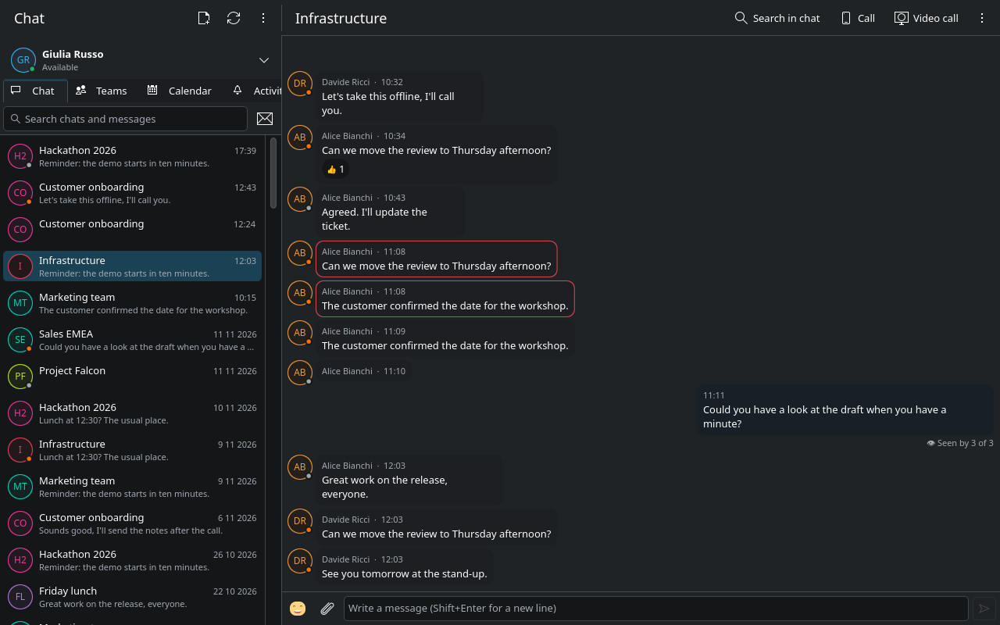
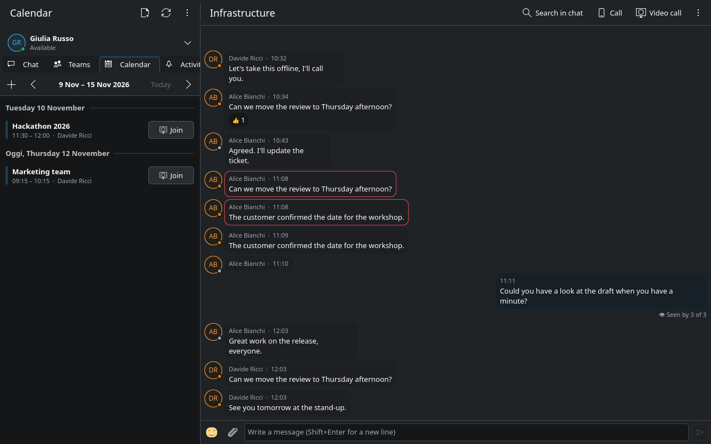

# KTeams

A **native** Microsoft Teams client for KDE Plasma (work / school accounts), written in
Qt 6 / Kirigami. No embedded browser: it talks to the Teams services directly, as the
official client does, and uses about 120 MB of memory against ~1 GB for Teams web.

The interface is in English, with an Italian translation picked automatically from the
system language. Status as of November 2026, honestly:

## Screenshots

Chats and a group conversation (demo data):

The calendar week, with meetings to join:

## Status

**Works, used every day**

- Sign-in with the normal Microsoft login (device code), session kept in the system wallet.
- Chats (one-to-one and groups) and teams/channels with threads: text with formatting,
  pictures, files (send, drag and drop, download), reactions, mentions, edit and delete,
  reply quotes, "seen by", "is typing", read state and unread counts.
- Chat management: pin, mute, hide; group chats renamed, people added, leaving.
- Audio calls: outgoing (one-to-one and group), incoming with ringtone, Teams' test call;
  echo cancellation and noise suppression; mute, hang up.
- Presence (own and others'), status message, Do not disturb.
- Calendar: week view, reminders, accept/decline, join; new meeting (through Microsoft Graph).
- Activity feed (mentions, replies, reactions) with filters and mark-all-read.
- Plasma notifications with sounds and pictures, tray icon with unread count, start at
  login, keyboard shortcuts.
- Search: chats by name, inside a chat (Ctrl+F), and across the recent messages of every chat.
- Local cache: everything reappears at once on start-up.

**Implemented, not yet confirmed on real calls**

- Camera in calls (sending works against Teams' media controller; receiving someone's video
  is verified only in a loopback test, not yet with a Teams user).
- Screen sharing (Plasma's picker through the desktop portal; same verification state).
- Joining meetings from the calendar (lobby, roster and the "someone is sharing" cases
  untested).
- Incoming video from Teams desktop clients, which offer their video section differently
  from Teams web (a renegotiation path exists for that).

**Not there yet**

- Several videos at once (a grid): one remote camera and one shared screen are shown.
- Teams' server-side message search (only recent messages are searched locally).
- Adaptive Cards and other app/bot content (shown as plain text or empty).
- Message formatting toolbar, forwarding, link previews.
- Meeting lobby, hand raising, in-meeting chat; hold and transfer; call keep-alive on very
  long calls.
- Settings page (audio/video devices, sounds); the camera is `/dev/video0` (or
  `KTEAMS_CAMERA`).
- Flatpak on Flathub (the Flatpak is built by GitHub Actions, see `packaging/README.md`);
  AppImage.

**Known limits**

- The protocol is Microsoft's own, undocumented one, learned from captures and from Teams
  web's code: a change on Microsoft's side can break a feature without notice.
- One account at a time.

## Install

Arch / CachyOS / Manjaro: `yay -S kteams-git` (AUR), or `makepkg -si` in
`packaging/arch/kteams-git/`. Dependencies come from pacman; details in `packaging/README.md`.

Any distribution: the Flatpak bundle (`kteams.flatpak`) built by GitHub Actions, from the
latest run or from a release: `flatpak install --user kteams.flatpak`.

From source (any distribution with Qt 6.5+, KF6, GStreamer 1.22+ with webrtcbin):

    cmake -S native -B native/build -DCMAKE_BUILD_TYPE=Release -DCMAKE_INSTALL_PREFIX=~/.local
    cmake --build native/build
    cmake --install native/build     # menu entry, icon, notification sounds

Then "KTeams" from the menu, or `kteams`.

## When something goes wrong

- Logs are in `~/.cache/kteams/kteams/kteams.log` (no tokens or secrets in
  them). Live: `QT_FORCE_STDERR_LOGGING=1 kteams`.
- During calls the log prints a `stats:` line every 5 seconds with the packets sent and
  received: "received" stuck at 0 means a network (TURN) or negotiation problem.
- "Sign out" in the tray menu really quits; closing the window keeps the app in the tray.
- Signing out of the account clears the cache and the token.

## For developers

- `native/`: the client. `src/` C++ (backend, Teams HTTP client, Trouter push channel, calls:
  `nativecall.*` signaling, `callengine.*` media), `qml/` the Kirigami interface,
  `translations/` the Qt Linguist files (source strings are English; after changing strings:
  `cmake --build native/build --target update_translations`, then fill the `.ts`).
- `native/docs/calling-protocol.md`: the Teams calling protocol as we understand it
  (Microsoft's SDP dialect, video source requests, meetings).
- `native/tests/offer_dump.cpp` → `kteams-offer-test`: prints the SDP offer, turns the
  camera on, and with `loop` runs a call between two engines in one process, without calling
  anyone. `cmake --build native/build --target kteams-offer-test`.
- Screenshots: `KTEAMS_DEMO=1` replaces every name, title and message with made-up ones;
  `KTEAMS_SCREENSHOT=file.png` (with `KTEAMS_START_TAB=0..3`) saves the window after
  `KTEAMS_SCREENSHOT_DELAY` seconds and quits. `docs/screenshots/` was made that way.
- `native/call/`: `kteams-capture`, Teams web in a QtWebEngine window, a developer tool only
  (`-DBUILD_CALL_HELPER=ON`): with `--capture` it records the protocol traffic, secrets
  masked. The app does not use it.
- The chat protocol comes from purple-teams; the calling one from captures and Teams web's
  code. Nothing is invented: every field was seen in a capture or in the code.

## License and disclaimer

KTeams is free software, released under the **GNU General Public License, version 3 or
later** (see `LICENSE`). It is written and maintained by Andrea Cimino with the help of
AI assistants.

KTeams is an **unofficial** client. It is not affiliated with, endorsed by or supported by
Microsoft. "Microsoft Teams" and "Microsoft" are trademarks of Microsoft Corporation. The
program talks to Teams through the same services the official clients use; those services
are not publicly documented and may change at any time, which can stop the program from
working without notice. Use it at your own risk and in accordance with the terms of service
of your organization's Microsoft 365 subscription: the authors accept no liability for any
damage, data loss or policy breach resulting from its use. The program is provided "as is",
without warranty of any kind, as stated in the license.

No usage data is collected: the program exchanges data only with Microsoft's services, on
your behalf, and keeps its cache and your session on your computer.
